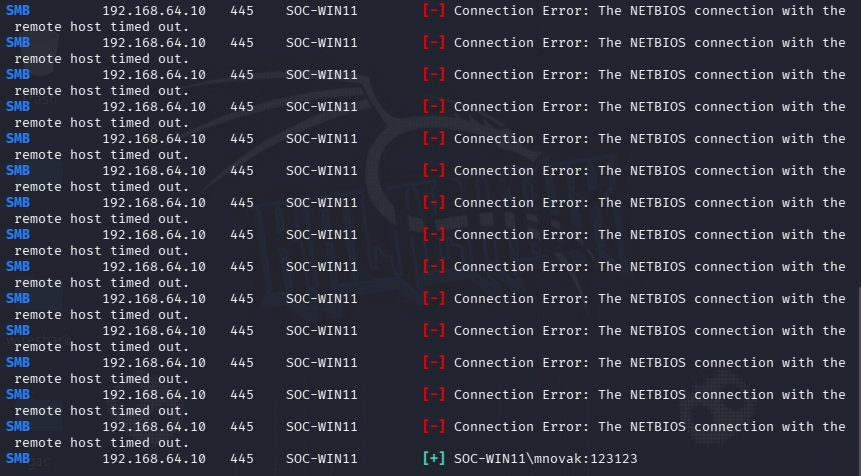
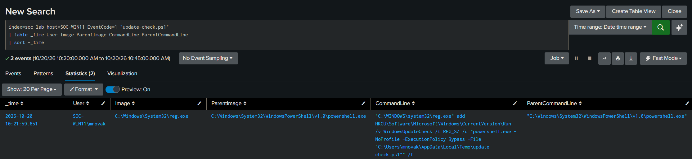
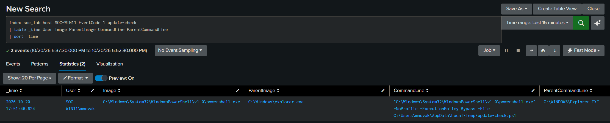
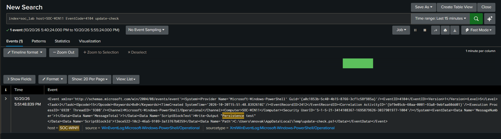

# SOC Authentication and Persistence Investigation

## Overview

This project is a small SOC investigation in my isolated home lab focused on suspicious login activity on a Windows endpoint.

Kali Linux was used to generate multiple SMB login attempts against a Windows 11 machine. Splunk was used to collect and analyze the related logs and alerts.

The investigation follows the activity from failed login attempts to a successful login and later persistence activity.

I used Splunk, Windows Security logs, Sysmon, and PowerShell logs to investigate the incident and create a simple timeline.

## Lab Environment

- **Kali Linux** - used to generate SMB login attempts
- **Windows 11 (SOC-WIN11)** - monitored endpoint
- **Splunk** - used for log collection, searching, alerts, and investigation
- **Splunk Universal Forwarder** - forwards Windows logs to Splunk
- **Sysmon** - detailed endpoint activity
- **PowerShell Script Block Logging** - used to review executed PowerShell code
- **Isolated VMware network** - used to keep the lab separated from the rest of the network

## Logs Used

During the investigation, I used the following Windows and Sysmon events:

- **Event ID 4625** - Failed logon
- **Event ID 4624** - Successful logon
- **Sysmon Event ID 1** - Process creation
- **PowerShell Event ID 4104** - Script Block Logging

## Detection and Alerts

The following alerts were triggered during the investigation:

- **Multiple Failed Logons** - detected repeated failed login attempts for the user mnovak
- **Suspicious Run Key Persistence** - detected the creation of a Registry Run key used for persistence

## Investigation

To simulate a brute-force attack, I used Kali Linux and a wordlist containing different passwords to attempt SMB logins to SOC-WIN11.

After multiple attempts, the tool reported a successful login using the password 123123.

I then checked the authentication logs in Splunk to investigate the login attempts.

### Failed Logon Attempts

The **Multiple Failed Logons** alert showed 39 failed network logon attempts for user `mnovak` from source IP `192.168.64.20`.

After seeing the repeated failed logons, I searched for **Event ID 4624**, which means a successful logon to check if the same source IP later authenticated successfully.

The search returned a successful **Logon Type 3 (Network)** event for `mnovak` from the same source IP, `192.168.64.20`.

This showed that the failed login attempts were followed by a successful network authentication from the same source.

### Persistence Activity

After confirming the successful login, I checked the second triggered alert, **Suspicious Run Key Persistence**.

The alert showed that a new Run key was created for user `mnovak`.

The Run key was configured to start a PowerShell script named `update-check.ps1` from the Temp folder.

I then searched for `update-check.ps1` to see what created it and whether it was executed.

### PowerShell Activity

I searched for `update-check.ps1` in the PowerShell logs.

The logs showed that PowerShell created `update-check.ps1` in the Temp folder.

The script contained: `Write-Output "Persistence test"`

I then found a Sysmon **Event ID 1**, which showed that PowerShell started `reg.exe`.

The command created a Run key named `WindowsUpdateCheck` that pointed to `update-check.ps1`.

### Persistence Execution

After logging in as `mnovak`, I searched for `update-check.ps1` in Sysmon process creation logs.

I found a Sysmon **Event ID 1** showing that `powershell.exe` was started from `explorer.exe` and executed `update-check.ps1` from the Temp folder.

This confirmed that the Run key persistence was triggered after the user logged in.

### Script Execution

I checked the PowerShell logs for `update-check.ps1`.

PowerShell **Event ID 4104** showed that the script executed: `Write-Output "Persistence test"`

## Timeline

[10:10:15] Multiple Failed Logons
- Target user: mnovak
- Failed logons: 39
- Logon Type: 3 (Network)
- Source IP: 192.168.64.20
- Host: SOC-WIN11
- Conclusion: Multiple failed network logon attempts were made for mnovak from 192.168.64.20.

[10:10:17] EventCode 4624 - Successful Logon
- User: mnovak
- Logon Type: 3 (Network)
- Source IP: 192.168.64.20
- Authentication Package: NTLM
- Conclusion: mnovak successfully logged in from the same IP that caused the failed logons.

[10:20:35] EventCode 4104 - PowerShell Script Block Logging
- PowerShell created update-check.ps1 in the Temp directory.
- Script content:
  Write-Output "Persistence test"
- Conclusion: PowerShell created the update-check.ps1 script.

[10:21:59] EventCode 1 - Sysmon Process Create
- User: SOC-WIN11\mnovak
- Image: reg.exe
- ParentImage: powershell.exe
- Registry value: WindowsUpdateCheck
- Conclusion: PowerShell started reg.exe and created a Run key that would execute update-check.ps1 at user logon.

[10:21:59] EventCode 4104 - PowerShell Script Block Logging
- PowerShell executed a reg add command.
- Target: HKCU\Software\Microsoft\Windows\CurrentVersion\Run
- Registry value: WindowsUpdateCheck
- Conclusion: PowerShell configured Run Key persistence for update-check.ps1.

[17:51:46] EventCode 1 - Sysmon Process Create
- User: SOC-WIN11\mnovak
- Image: powershell.exe
- ParentImage: explorer.exe
- CommandLine: powershell.exe -File \Temp\update-check.ps1
- Conclusion: PowerShell started update-check.ps1 after mnovak logged in.

[17:51:48] EventCode 4104 - PowerShell Script Block Logging
- Script: update-check.ps1
- ScriptBlockText: Write-Output "Persistence test"
- Conclusion: PowerShell logs confirmed that update-check.ps1 was executed.

## Conclusion

The investigation started with multiple failed SMB login attempts against the user `mnovak`.

A successful network logon was later found from the same source IP. After that, PowerShell activity and a Registry Run key were used to create persistence on the Windows endpoint.

The Run key was configured to execute `update-check.ps1` when the user logged in. Sysmon and PowerShell logs confirmed that the script was later started and executed.
