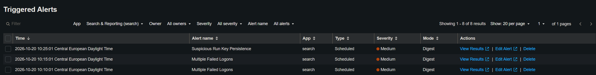
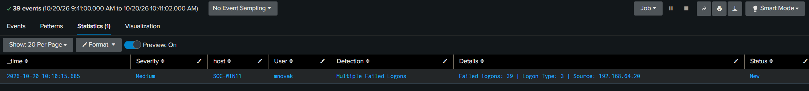
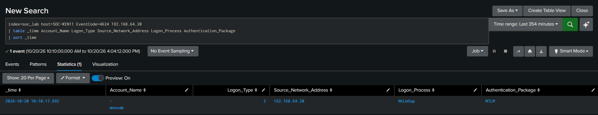
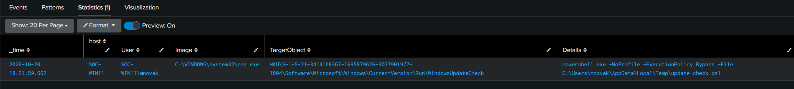
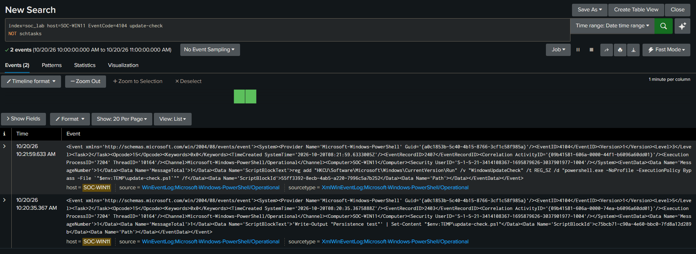

# SOC Brute Force and Persistence Investigation

## Overview

This project is a small SOC investigation in my isolated home lab focused on suspicious login activity on a Windows endpoint.

Kali Linux was used to generate multiple SMB login attempts against a Windows 11 machine. Splunk was used to collect and analyze the related logs and alerts.

The investigation follows the activity from failed login attempts to a successful login and later persistence activity.

I used Splunk, Windows Security logs, Sysmon, and PowerShell logs to investigate the incident and create a simple timeline.

## Lab Environment

- **Kali Linux** - used to generate SMB login attempts
- **Windows 11 (SOC-WIN11)** - monitored endpoint
- **Splunk** - used for log collection, searching, alerts, and investigation
- **Splunk Universal Forwarder** - forwards Windows logs to Splunk
- **Sysmon** - detailed endpoint activity
- **PowerShell Script Block Logging** - used to review executed PowerShell code
- **Isolated VMware network** - used to keep the lab separated from the rest of the network

## Logs Used

During the investigation, I used the following Windows and Sysmon events:

- **Event ID 4625** - Failed logon
- **Event ID 4624** - Successful logon
- **Sysmon Event ID 1** - Process creation
- **PowerShell Event ID 4104** - Script Block Logging

## Detection and Alerts

The following alerts were triggered during the investigation:

- **Multiple Failed Logons** - detected repeated failed login attempts for the user mnovak
- **Suspicious Run Key Persistence** - detected the creation of a Registry Run key used for persistence



## Investigation

### Failed Logon Attempts

The **Multiple Failed Logons** alert showed 39 failed network logon attempts for user `mnovak` from source IP `192.168.64.20`.



After seeing the repeated failed logons, I searched for **Event ID 4624**, which means a successful logon to check if the same source IP later authenticated successfully.

The search returned a successful **Logon Type 3 (Network)** event for `mnovak` from the same source IP, `192.168.64.20`.



This showed that the failed login attempts were followed by a successful network authentication from the same source.

### Persistence Activity

After confirming the successful login, I checked the second triggered alert, **Suspicious Run Key Persistence**.

The alert showed that a new Run key was created for user `mnovak`.

The Run key was configured to start a PowerShell script named `update-check.ps1` from the Temp folder.

I then searched for `update-check.ps1` to see what created it and whether it was executed.



### PowerShell Activity

I searched for `update-check.ps1` in the PowerShell logs.

The logs showed that PowerShell created `update-check.ps1` in the Temp folder.

The script contained:

```powershell
Write-Output "Persistence test"
```

